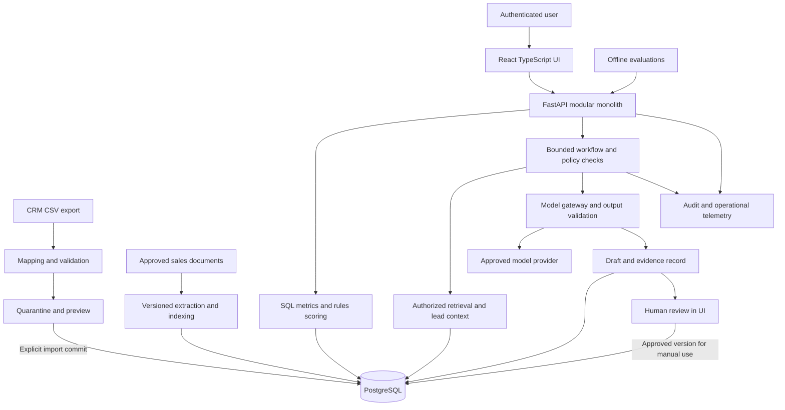

# Architecture proposal and decision record

Status: proposed, pending architecture approval. No components are provisioned.

## Components and data flows

The model receives a minimized context, never direct database credentials. The server validates all tool parameters and evidence IDs. No email, messaging, or CRM mutation adapter exists in the approved initial scope. Manual use takes place outside RevenueOS under the business's ordinary process.

## Deployment and module boundaries

Use one repository, one Python application, one TypeScript frontend, and one database. Suggested future modules: ingestion, CRM domain, analytics, scoring, knowledge, recommendations, review, identity/policy, evaluation, telemetry. Business services depend on typed repositories and provider interfaces; HTTP handlers stay thin. Separate a job process from the same codebase for imports/indexing only when needed; this is not a new microservice.

Local setup: Docker Compose for PostgreSQL and the application, lockfiles, explicit migrations, `.env.example` with placeholders, deterministic synthetic seed, and one documented setup command. UI can run separately for development and be served as static assets behind the same origin in deployment. The approved build will choose supported exact versions rather than infer compatibility from this document.

Demo deployment: one small container host plus persistent PostgreSQL, TLS reverse proxy, synthetic records only, restricted demo account and generation quotas. Real pilot: private authenticated access, managed PostgreSQL/backups, approved provider connection and storage, separate environment and credentials. Choose a vendor after constraints are known; no cloud-specific architecture is required. Backup and availability pricing must fit an explicit pilot budget even if it exceeds the provisional demo ceiling.

## Major choices and simpler alternatives

| Choice | Why appropriate | Simpler alternative and tradeoff | Trigger to revisit |
|---|---|---|---|
| Modular monolith | Keeps transactions, deployment, debugging, and cost manageable | One unstructured script is faster initially but obscures policy and testing | Independent scaling or ownership is demonstrated |
| Python + FastAPI + Pydantic | Typed request/response validation and generated API contract fit data/AI workflows; [official features](https://fastapi.tiangolo.com/features/) | Streamlit for a disposable internal prototype; weaker fit for intended separate product UI | Only use Streamlit if product UI scope is removed |
| React + TypeScript + Vite | Adequate for authenticated dashboard without server-rendering complexity | Server-rendered templates and small JavaScript enhancements reduce tooling | Prefer simpler UI if timeline dominates; Next.js only if server-rendering needs arise |
| PostgreSQL + SQLAlchemy + Alembic | Relational integrity, SQL analytics, history, and migrations in one store | SQLite for local-only single-user experiments; less representative of concurrent pilot access | No distributed DB or warehouse before measured need |
| PostgreSQL full-text search first | One store, explainable lexical retrieval; [native search capability](https://www.postgresql.org/docs/current/textsearch.html) | Curated keyword/title filtering; cheaper but weaker discovery | Retrieval benchmark shows material semantic failures |
| Optional pgvector exact search + lexical fusion | Adds semantic matches without separate vector service; [extension supports exact and approximate search](https://github.com/pgvector/pgvector) | Retain full-text retrieval if it passes gates | Add embeddings only after measured quality/cost benefit; ANN only after scale tests |
| Versioned points-based scoring | Explainable without training labels | FIFO/newest-first is the comparator and operational fallback | Leakage-safe real labels justify supervised challenger |
| One provider adapter with strict schema validation | Limits vendor coupling without speculative multi-provider orchestration | Fixed templates for next actions and outreach; less flexible but cheaper | Provider constraints or evaluation justify replacement |
| Explicit state machine with bounded tool calls | Auditable agentic behavior without a framework dependency | Fixed sequential pipeline; use this until tool choice adds demonstrated value | More complex orchestration only with a tested need |
| Database jobs, conditional | Durable work with leases/retries in existing infrastructure | Synchronous bounded import for tiny files | Request timeouts or restart tests demonstrate need for jobs; Redis/Celery later |
| Managed OIDC for pilot | Avoid building password/MFA lifecycle | Local synthetic demo identity stub | Stub must be disabled before any real data or hosted private pilot |
| Structured logs + metrics + trace IDs | Trace failures and spend with modest infrastructure | Local structured logs and run ledger initially | Add dedicated telemetry backend when retention/search needs warrant |
| Docker Compose and simple CI | Reproducibility without cluster management | Documented local virtualenv + PostgreSQL service | Kubernetes only for an actual operational requirement |

PostgreSQL RLS can provide an additional database boundary, but owner and privileged roles can bypass it; runtime must use a restricted non-owner role and tested policies. See [official row-security behavior](https://www.postgresql.org/docs/current/ddl-rowsecurity.html). Deployment-per-business remains the initial isolation choice.

## Interface contracts (design only)

| Boundary | Proposed contract |
|---|---|
| Import preview/commit | `ImportReport`: source hash, schema/map version, accepted/quarantined counts, field errors, dataset mode; commit uses idempotency key and report hash |
| Analytics | `MetricResult`: metric/version, interval/timezone, numerator/denominator, value/unit, exclusions, as_of, snapshot_id |
| Scoring | `ScoreResult`: lead_id, eligibility, rank_points, components, missing_features, ruleset_version, feature_snapshot_id |
| Retrieval | `EvidenceSet`: query, authorization scope, document/version/chunk IDs, exact passage locators, retrieval config version |
| Model gateway | Validated recommendation object or typed failure; model/prompt/schema versions, token usage, billed/estimated cost status |
| Review | Expected draft version + content hash + decision + reviewer; transactional compare-and-set prevents stale approval |

Proposed endpoint families: `/imports`, `/metrics`, `/leads`, `/knowledge/search`, `/recommendations`, `/drafts/{id}/reviews`, `/evaluations`, `/health`. Exact API specifications follow approval. Use explicit pagination, filter allowlists, rate limits, and consistent typed errors. No generated freeform SQL endpoint.

## Failure and resource policy

Start with 10 MB CSV uploads and 10,000 rows per file, 20 MB per document, 200 documents, 20 chunks retrieved for candidate selection, five evidence chunks sent to generation, 12,000 input-token and 1,500 output-token ceilings. Values are tunable proposed limits, tested before release. PDF extraction, if admitted, must be sandboxed and resource-limited; begin with UTF-8 text/Markdown to reduce parser risk.

Workflow states: requested → authorized → context_ready → generated → validated → review_pending; terminal failed/abstained/cancelled states are explicit. At most four read tool calls and two total generation attempts, within a 30-second deadline. A transient provider error may use the second attempt; invalid output may also consume that same retry budget. Never stack retry layers. Retry with jitter only for transient failures. Token reservations cover both attempts and reconcile after completion; quota exhaustion fails closed before calling the provider.

Imports use staging and atomic publication of a dataset version. Jobs use lease owner, expiry, attempt count, heartbeat, and bounded retries; dead jobs remain inspectable. Replays are idempotent. Recheck authorization, current source versions, and suppression policy before opening a review. Model outage produces a deterministic next-action template or abstention. Never silently substitute generated facts.
