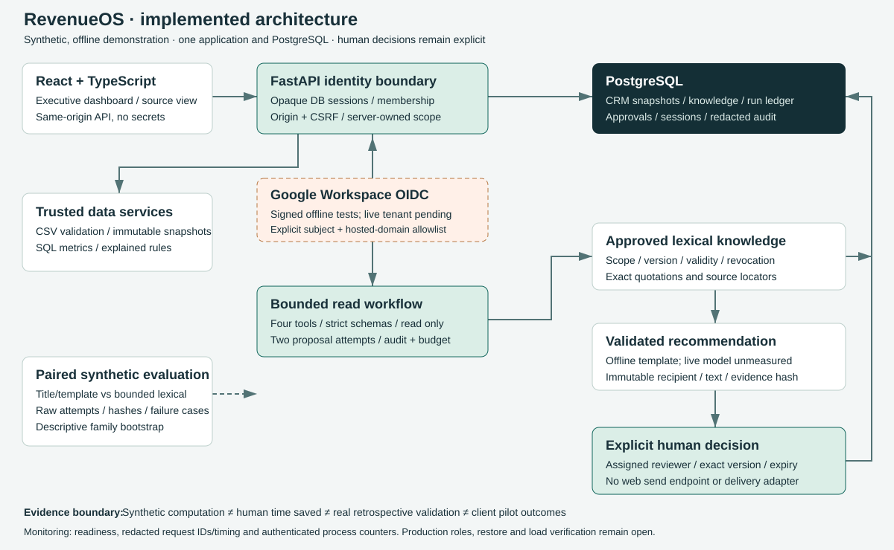
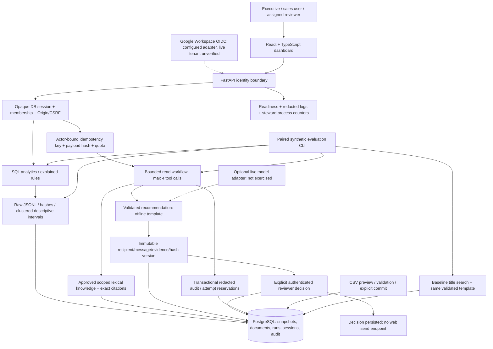

# Implemented architecture and evidence boundaries

Current hardening adds a non-owner runtime role, organization/document RLS, transaction-local identity scope, focused evidence selection, request idempotency and steward-only interruption reconciliation. See [design details](28-improvements-guide.md) and [current verification](29-improvements-verification.md). The SVG below predates these additions; the flow remains a single modular application.

The four read tools cannot select organization/actor/lead, execute SQL, call URLs, assign reviewers or perform writes. The model/provider path has no email/CRM mutation adapter. Existing operator-only approval rehearsal records `delivered=false`; the dashboard exposes decisions only. Google integration is offline-tested with signed mock tokens and policy cases; no live tenant/client credentials were configured.

Deployment is one application/static frontend container, one PostgreSQL instance and a TLS reverse proxy, with no premature microservices. The compiled SPA contains no provider/client secret or identity mapping. SQL/knowledge scope is server-owned. A restricted runtime role/RLS, restore/retention, hosted OAuth and load verification remain prerequisite pilot hardening, not completed controls.

The evaluation lane records synthetic computation, not client behavior. It never converts API milliseconds into human task-time savings or synthetic outcomes into predictive accuracy. See the protocol in docs/21-comparison-acceptance.md and results in docs/23-comparison-report.md.
