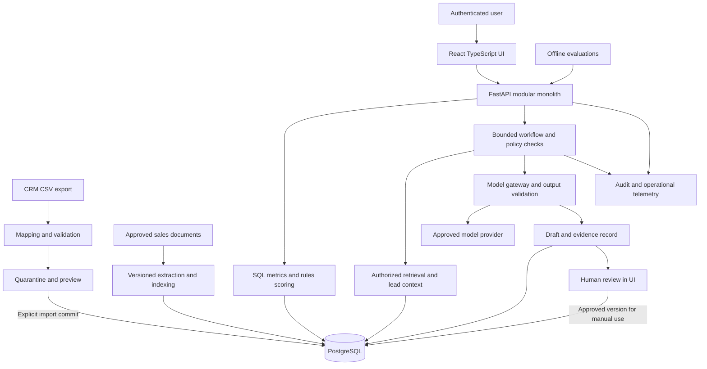

# RevenueOS planning pack

Status: proposed architecture; awaiting owner approval. Date: 2026-10-16.

RevenueOS helps B2B SaaS teams decide which inbound leads to work, understand the evidence, and prepare outreach for human review. The first product slice is **validated CSV → trusted metrics → explained priority → cited recommendation → reviewed draft**.

No application, migrations, model integrations, infrastructure, or feature tests have been implemented. This pack defines the work to approve first.

## Reading order and deliverables

| Document | Contents | Requested deliverables |
|---|---|---|
| [Product requirements](#01-product-requirements) | Problem, personas, scope, stories, metric definitions | A, B, C |
| [Architecture and decisions](#02-architecture) | Components, flows, interfaces, alternatives, deployment | D; technical decisions |
| [Data model](#03-data-model) | Tables, relationships, constraints, history, ingestion | E |
| [AI design](#04-ai-design) | Rules, ML, retrieval, structured generation, bounded tools | F |
| [Security and governance](#05-security-governance) | Access, privacy, approvals, threats, operational controls | G |
| [Evaluation](#06-evaluation) | Baselines, datasets, gates, measurement protocols | H |
| [Roadmap and risks](#07-roadmap-risks) | Phases, acceptance, dependencies, risk register | I, J |
| [Pilot and business impact](#08-pilot-roi) | Recruitment, experiments, costs, ROI evidence | K |

## Repository inspection

The supplied working directory was inspected, including hidden-file discovery and applicable ancestor `AGENTS.md` checks. Initially only empty `work/` and `outputs/` directories existed. No source, documentation, configuration, datasets, or applicable `AGENTS.md` files were found. `git rev-parse` and `git status` reported that this directory is not a Git repository. There is no existing application to preserve or Git diff to report. Inspection scope is this workspace and its instruction ancestors, not unrelated user directories.

## Decision status and assumptions

| Item | Status | Design implication |
|---|---|---|
| B2B SaaS inbound sales | Confirmed by owner | Prioritize first-response and qualification workflows |
| Small team, 5–20 commercial users | Assumption | Single-business pilot; modest concurrency |
| CSV first, pilot data access unknown | Assumption pending answer | Synthetic-only demonstration until data approval |
| Approximately 10,000 leads, 100,000 interactions, 200 approved documents | Planning workload assumption | Load-test envelope; not customer evidence |
| English, one reporting timezone, one currency per pilot | Assumption | Preserve UTC source times; no currency aggregation without conversion policy |
| Provider-neutral, hosted model allowed for synthetic data | Proposal | Real data requires separate provider/privacy review |
| $100/month demo operations ceiling | Provisional budget target | Includes hosting/model usage; excludes engineering labor; no price estimate asserted |
| 30-day qualification outcome, 90-day revenue follow-up | Proposed business definitions | Owner must align with actual sales cycle before pilot |
| Team-wide access to approved internal sales documents | Assumption | Add finer document scopes before restricted material is admitted |

All numerical quality, latency, cost, and impact targets in this pack are **proposed acceptance criteria**, not measured results. No ROI, model accuracy, runtime benchmark, or user adoption has been measured. Synthetic outcomes demonstrate plumbing and evaluation mechanics only.

## Approval requested

Approve or amend the modular monolith, rules-first prioritization, PostgreSQL search-first RAG, provider adapter, single-business pilot, and draft-only human approval boundary. Pending material inputs are pilot data availability and mandatory hosting/provider/residency/budget constraints. Those can change pilot scope; they do not prevent review of this proposal. Implementation stays blocked until explicit architecture approval.

## Evidence and references

Official technical references were checked on 2026-10-16 and are linked beside relevant decisions. They substantiate component capabilities and design considerations; they do not substantiate RevenueOS performance. Exact supported dependency versions and provider pricing must be selected and locked during implementation.

---

# Product requirements, business problem, and personas

## Problem statement

A B2B SaaS commercial team receives inbound leads while its CRM mixes incomplete profiles, interaction records, opportunities, and inconsistent outcomes. Representatives spend time assembling context and locating approved product information. Managers cannot consistently explain why leads receive attention, whether response delays matter, or whether AI suggestions improve work.

RevenueOS tests the hypothesis that a visible, consistent queue plus evidence-backed preparation can reduce review effort without reducing qualification quality. Slow follow-up, missed opportunities, and inconsistent messaging are plausible problems to validate with a pilot sponsor, not established findings about a particular company. The CRM remains the system of record.

Before development, interview two representatives, one RevOps operator, and the sponsor. Observe five actual lead-review tasks if authorized; record elapsed time, rework, source systems, data availability, and the definition of a qualified lead. Collect baseline volumes and conversion denominators. Reprioritize the scope if context assembly is not a material problem.

## Representative personas

These are design personas, not interviewed users.

| Persona | Job and friction | Core workflow | Success evidence |
|---|---|---|---|
| Maya, inbound sales representative | Must decide whom to contact; context is scattered and suggestions can be hard to trust | Review queue → inspect score reasons and source evidence → edit/reject draft → approve for manual use | Less time per review, acceptable drafts, fewer factual corrections |
| Jordan, RevOps manager | Owns CRM hygiene and routing; inconsistent timestamps and stage definitions weaken reporting | Map CSV fields → resolve quarantine → inspect freshness and funnel → review exceptions | Reconciled metrics, explainable ordering, reproducible imports |
| Alex, head of sales and pilot sponsor | Needs credible operational value and clear risk ownership | Inspect executive metrics, adoption, costs, and controlled pilot results | Faster work with no material quality harm; auditable value claim |

## Product scope

The minimum valuable release includes CSV preview/validation, dataset lineage, a lead queue with transparent score contributions, deterministic dashboard metrics, approved-document search with citations, and a bounded recommendation/draft workflow. Every draft is visibly unapproved until a named person reviews it. Every page identifies synthetic datasets and data freshness.

Next, add evaluations, auditability, operational controls, and a reproducible demo. A real pilot follows readiness review. API-based CRM ingestion, semantic retrieval, and supervised scoring are conditional enhancements. No autonomous sending, CRM writes, arbitrary SQL agent, general-purpose web browsing, autonomous prospecting, fine-tuning, revenue forecasting, or multi-agent framework is in the first release. No dependency on classical ML to deliver the initial value.

## Functional requirements and acceptance

| ID | User need | Acceptance criterion |
|---|---|---|
| P1 | Trust imported data | Preview mapping; report row/field errors; quarantine invalid rows; explicit commit; replay causes no duplicate business records |
| P2 | Understand sales performance | Each metric has SQL definition, period, source version, denominator, missing-data count, and freshness; reconcile fixed fixtures exactly |
| P3 | Work an explained queue | Show score version, as-of time, eligibility, components, missing values, and deterministic tie-break; allow baseline comparison |
| P4 | Find approved knowledge | Search authorized current versions only; open citations to exact passages; abstain when evidence is insufficient |
| P5 | Prepare a next action | Typed output separates recommendation, evidence, missing facts, and draft; only permitted actions accepted |
| P6 | Retain control | Reviewer can edit/reject/approve; edits invalidate prior approval; approval never triggers external delivery |
| P7 | Explain system behavior | Trace import, features, sources, prompts/models, validation, cost, review, and evaluation by run ID |
| P8 | Demonstrate responsibly | Seeded synthetic scenario, reproducible setup, limits and failure demo, and results ledger distinguishing simulated from observed |

## Executive metric contract

- Inbound leads: distinct eligible external lead IDs created in the selected interval, grouped by source; test/internal records excluded by explicit rules.
- First response: earliest human outbound contact after lead creation minus creation time. Report median/p90 and unresolved counts separately; exclude automated acknowledgments and never substitute draft approval for contact. Business-hour timing is deferred.
- Qualification rate: leads qualified within 30 days / eligible leads with a complete 30-day follow-up window. Missing observation is unknown, not failure. Report cohort dates and exclusions.
- Win rate: won opportunities / (won + lost opportunities) closed in the interval; show open count separately. This is different from lead conversion.
- Open pipeline: sum of open opportunity amounts as of the snapshot, in one currency. Label as pipeline, never realized revenue. Do not claim historical pipeline without historical state.
- AI acceptance: approved draft versions / reviewed draft versions, paired with edit rate and independent quality review. Acceptance is not factual correctness or ROI.

Qualification and eligibility definitions are versioned with the sponsor. Use contact/opportunity linkage to avoid counting several opportunities as several converted leads. Historical cohort reporting is unavailable when snapshot/history coverage cannot support it.

## Experience and operational constraints

Support keyboard navigation, readable evidence links, empty/error/loading states, actionable validation messages, and explicit stale-data banners. Target dashboard p95 ≤2 seconds and draft workflow p95 ≤15 seconds at the declared evaluation workload. Provide cancellation and a safe failure state; provider downtime leaves analytics and rules usable. These are release targets requiring measurement.

The interview narrative should show one successful case, one abstention, one rejected malicious document instruction, and one outage fallback. A credible demonstration explains denominators, lineage, tradeoffs, and failed hypotheses, not just an attractive generated answer.

---

# Architecture proposal and decision record

Status: proposed, pending architecture approval. No components are provisioned.

## Components and data flows

The model receives a minimized context, never direct database credentials. The server validates all tool parameters and evidence IDs. No email, messaging, or CRM mutation adapter exists in the approved initial scope. Manual use takes place outside RevenueOS under the business's ordinary process.

## Deployment and module boundaries

Use one repository, one Python application, one TypeScript frontend, and one database. Suggested future modules: ingestion, CRM domain, analytics, scoring, knowledge, recommendations, review, identity/policy, evaluation, telemetry. Business services depend on typed repositories and provider interfaces; HTTP handlers stay thin. Separate a job process from the same codebase for imports/indexing only when needed; this is not a new microservice.

Local setup: Docker Compose for PostgreSQL and the application, lockfiles, explicit migrations, `.env.example` with placeholders, deterministic synthetic seed, and one documented setup command. UI can run separately for development and be served as static assets behind the same origin in deployment. The approved build will choose supported exact versions rather than infer compatibility from this document.

Demo deployment: one small container host plus persistent PostgreSQL, TLS reverse proxy, synthetic records only, restricted demo account and generation quotas. Real pilot: private authenticated access, managed PostgreSQL/backups, approved provider connection and storage, separate environment and credentials. Choose a vendor after constraints are known; no cloud-specific architecture is required. Backup and availability pricing must fit an explicit pilot budget even if it exceeds the provisional demo ceiling.

## Major choices and simpler alternatives

| Choice | Why appropriate | Simpler alternative and tradeoff | Trigger to revisit |
|---|---|---|---|
| Modular monolith | Keeps transactions, deployment, debugging, and cost manageable | One unstructured script is faster initially but obscures policy and testing | Independent scaling or ownership is demonstrated |
| Python + FastAPI + Pydantic | Typed request/response validation and generated API contract fit data/AI workflows; [official features](https://fastapi.tiangolo.com/features/) | Streamlit for a disposable internal prototype; weaker fit for intended separate product UI | Only use Streamlit if product UI scope is removed |
| React + TypeScript + Vite | Adequate for authenticated dashboard without server-rendering complexity | Server-rendered templates and small JavaScript enhancements reduce tooling | Prefer simpler UI if timeline dominates; Next.js only if server-rendering needs arise |
| PostgreSQL + SQLAlchemy + Alembic | Relational integrity, SQL analytics, history, and migrations in one store | SQLite for local-only single-user experiments; less representative of concurrent pilot access | No distributed DB or warehouse before measured need |
| PostgreSQL full-text search first | One store, explainable lexical retrieval; [native search capability](https://www.postgresql.org/docs/current/textsearch.html) | Curated keyword/title filtering; cheaper but weaker discovery | Retrieval benchmark shows material semantic failures |
| Optional pgvector exact search + lexical fusion | Adds semantic matches without separate vector service; [extension supports exact and approximate search](https://github.com/pgvector/pgvector) | Retain full-text retrieval if it passes gates | Add embeddings only after measured quality/cost benefit; ANN only after scale tests |
| Versioned points-based scoring | Explainable without training labels | FIFO/newest-first is the comparator and operational fallback | Leakage-safe real labels justify supervised challenger |
| One provider adapter with strict schema validation | Limits vendor coupling without speculative multi-provider orchestration | Fixed templates for next actions and outreach; less flexible but cheaper | Provider constraints or evaluation justify replacement |
| Explicit state machine with bounded tool calls | Auditable agentic behavior without a framework dependency | Fixed sequential pipeline; use this until tool choice adds demonstrated value | More complex orchestration only with a tested need |
| Database jobs, conditional | Durable work with leases/retries in existing infrastructure | Synchronous bounded import for tiny files | Request timeouts or restart tests demonstrate need for jobs; Redis/Celery later |
| Managed OIDC for pilot | Avoid building password/MFA lifecycle | Local synthetic demo identity stub | Stub must be disabled before any real data or hosted private pilot |
| Structured logs + metrics + trace IDs | Trace failures and spend with modest infrastructure | Local structured logs and run ledger initially | Add dedicated telemetry backend when retention/search needs warrant |
| Docker Compose and simple CI | Reproducibility without cluster management | Documented local virtualenv + PostgreSQL service | Kubernetes only for an actual operational requirement |

PostgreSQL RLS can provide an additional database boundary, but owner and privileged roles can bypass it; runtime must use a restricted non-owner role and tested policies. See [official row-security behavior](https://www.postgresql.org/docs/current/ddl-rowsecurity.html). Deployment-per-business remains the initial isolation choice.

## Interface contracts (design only)

| Boundary | Proposed contract |
|---|---|
| Import preview/commit | `ImportReport`: source hash, schema/map version, accepted/quarantined counts, field errors, dataset mode; commit uses idempotency key and report hash |
| Analytics | `MetricResult`: metric/version, interval/timezone, numerator/denominator, value/unit, exclusions, as_of, snapshot_id |
| Scoring | `ScoreResult`: lead_id, eligibility, rank_points, components, missing_features, ruleset_version, feature_snapshot_id |
| Retrieval | `EvidenceSet`: query, authorization scope, document/version/chunk IDs, exact passage locators, retrieval config version |
| Model gateway | Validated recommendation object or typed failure; model/prompt/schema versions, token usage, billed/estimated cost status |
| Review | Expected draft version + content hash + decision + reviewer; transactional compare-and-set prevents stale approval |

Proposed endpoint families: `/imports`, `/metrics`, `/leads`, `/knowledge/search`, `/recommendations`, `/drafts/{id}/reviews`, `/evaluations`, `/health`. Exact API specifications follow approval. Use explicit pagination, filter allowlists, rate limits, and consistent typed errors. No generated freeform SQL endpoint.

## Failure and resource policy

Start with 10 MB CSV uploads and 10,000 rows per file, 20 MB per document, 200 documents, 20 chunks retrieved for candidate selection, five evidence chunks sent to generation, 12,000 input-token and 1,500 output-token ceilings. Values are tunable proposed limits, tested before release. PDF extraction, if admitted, must be sandboxed and resource-limited; begin with UTF-8 text/Markdown to reduce parser risk.

Workflow states: requested → authorized → context_ready → generated → validated → review_pending; terminal failed/abstained/cancelled states are explicit. At most four read tool calls and two total generation attempts, within a 30-second deadline. A transient provider error may use the second attempt; invalid output may also consume that same retry budget. Never stack retry layers. Retry with jitter only for transient failures. Token reservations cover both attempts and reconcile after completion; quota exhaustion fails closed before calling the provider.

Imports use staging and atomic publication of a dataset version. Jobs use lease owner, expiry, attempt count, heartbeat, and bounded retries; dead jobs remain inspectable. Replays are idempotent. Recheck authorization, current source versions, and suppression policy before opening a review. Model outage produces a deterministic next-action template or abstention. Never silently substitute generated facts.

---

# Database and ingestion proposal

This is a logical schema, not executable DDL or migrations. Start with one business per deployment. Include `organization_id` on owned records to make scope explicit, but do not claim multi-tenant readiness.

## Conventions and relationships

UUID primary keys; `timestamptz` for UTC instants; money as fixed precision numeric plus ISO currency; controlled enums for stages/statuses; JSONB only for versioned payloads, feature explanations, and provider metadata. Required business fields remain typed columns. All domain references must match organization via composite foreign keys `(organization_id, id)`. Audit the same invariant for optional polymorphic evidence references in service validation and database constraints where representable.

An organization has memberships, imports, accounts, leads, and documents. An account has many leads/opportunities. A lead has many interactions and can link to multiple opportunities through an explicit bridge. Score runs reference immutable feature snapshots; recommendations reference runs, citations, and draft versions. Draft reviews bind exact versions. Evaluation cases and pilot assignments reference pinned datasets and policies.

## Proposed tables

| Table | Principal fields and constraints | Purpose |
|---|---|---|
| organizations | id, name, reporting_timezone, default_currency, data_mode | Business scope; mode is synthetic or real; never silently mix |
| users / memberships | user: id, oidc_subject unique; membership: organization_id, user_id, role, active | Identity and roles; role changes audited |
| import_batches | id, organization_id, source_system, file_hash, mapping_version, schema_version, mode, status, counts, received_at, committed_at | Unique organization/source/hash/map tuple prevents replay; explicit force-reimport creates lineage |
| import_errors | batch_id, row_number, field, error_code, redacted_excerpt | Quarantine report; full raw PII excluded from error messages |
| datasets | id, organization_id, import_batch_id, version, observed_at, published_at, coverage_start/end, mode | Published snapshot/version for analytics and replay |
| accounts | id, organization_id, source_system, external_id, name, domain, industry, employee_band, source_updated_at | Unique organization/source/external_id; do not auto-merge on name |
| leads | id, organization_id, source_system, external_id, account_id nullable, owner_user_id nullable, source, status, created_at, source_updated_at, do_not_contact, deleted_at | Mutable current projection; unique source ID; unknown owner preserved |
| lead_private | organization_id, lead_id unique, name, email, lawful_use_status, retention_until | Restricted contact fields; only fetched when required |
| lead_versions | id, organization_id, lead_id, dataset_id, observed_at, source_effective_at, attributes, import_batch_id | Immutable state history; source-effective time can be unknown |
| interactions | id, organization_id, source_system, external_id, lead_id, occurred_at, ingested_at, direction, channel, actor_type, summary, import_batch_id | Unique source ID; distinguish human from automation; missing timestamp quarantined |
| opportunities | id, organization_id, source_system, external_id, account_id, owner_user_id, current_stage, amount, currency, created_at, closed_at, outcome | Check nonnegative amounts; terminal outcome/date consistency |
| opportunity_leads | organization_id, opportunity_id, lead_id, attribution_role | Unique pair; use distinct leads in conversion metrics |
| opportunity_stage_events | id, organization_id, opportunity_id, from_stage, to_stage, effective_at, observed_at, source_event_id | Immutable stage transitions; replay/dedup by source event |
| opportunity_versions | id, organization_id, opportunity_id, dataset_id, observed_at, source_effective_at, amount, currency, stage, outcome | Historical amount/stage snapshots for as-of analytics |
| lead_outcomes | id, organization_id, lead_id, label_definition_version, window_start/end, qualified_at nullable, observation_complete, label, provenance | Unique lead/definition/window; distinguish censored, positive, negative, unknown |
| documents | id, organization_id, title, access_scope, steward_user_id, status | Logical document; team or restricted scope |
| document_versions | id, organization_id, document_id, version, content_hash, storage_ref, approved_by/at, valid_from/until, revoked_at, extraction_version | Immutable approved content; new version requires approval |
| document_chunks | id, organization_id, document_version_id, ordinal, text, page/heading, start/end_offset, text_hash, search_vector | Unique version/ordinal; passage locator survives retrieval |
| chunk_embeddings (conditional) | organization_id, chunk_id, embedding_model_version, dimensions, vector | Added only after retrieval gate; never mix incompatible vectors |
| feature_snapshots | id, organization_id, lead_id, as_of, dataset_id, feature_schema_version, values, missingness, source_refs | Historical reproducibility, no future outcomes |
| score_runs | id, organization_id, feature_snapshot_id, scorer_type/version, eligible, points, components, run_at | Points are not probability; stable ordering by lead ID |
| workflow_runs | id, organization_id, requester_id, lead_id, state, idempotency_key, config_versions, input_hash, source_snapshot_id, started/ended_at, failure_code | Workflow ownership, policy state, replay lineage |
| model_calls | id, organization_id, workflow_run_id, attempt, provider/model_version, prompt_version, schema_version, input/output_tokens, latency_ms, cost_amount/currency, cost_status, status | Failed attempts included; unknown usage flagged and reconciled |
| usage_budgets / usage_reservations | budget: organization_id, period, approved_limit, spent, reserved; reservation: workflow_run_id, amount, state, expires_at | Atomically reserve worst-case bounded spend before calls; reconcile usage; expired uncertain calls require reconciliation before release of funds |
| recommendations | id, organization_id, workflow_run_id, score_run_id, action, rationale, missing_information, validation_status | Typed recommendation; no arbitrary execution payload |
| evidence_refs | id, organization_id, recommendation_id, claim_key, chunk_id nullable, feature_snapshot_id nullable, metric_ref nullable, excerpt_hash | Exactly one source kind; claim-to-source linkage |
| drafts / draft_versions | draft: id, organization_id, recommendation_id, current_version; version: id, draft_id, version, body, subject, content_hash, created_by, created_at, expires_at | Immutable versions with revision lineage; private content access |
| reviews | id, organization_id, draft_version_id, reviewer_id, decision, reason, reviewed_at, reviewed_hash | Unique terminal decision per version; stale versions cannot approve |
| audit_events | id, organization_id, actor_id/type, action, entity_type/id, correlation_id, timestamp, redacted_change, previous_hash | Append-only runtime permissions; hash chain is detection, not tamper-proof storage |
| jobs (conditional) | id, organization_id, type, input_ref, idempotency_key, state, lease_owner/until, attempts, heartbeat, next_attempt_at | Durable imports/indexing from same application |
| evaluation_cases / evaluation_runs / evaluation_results | case: dataset/version, task, expected sources/labels, slice; run: config/commit/environment; result: case_id, output_ref, metrics, reviewer | Reproducible comparison with case-level evidence |
| pilot_assignments / pilot_events | assignment: account_id, arm, stratum, assignment_time, experiment_version; event: task_id, actor, type, timestamp, duration, outcome/source | Frozen treatment and denominators; review time separated from sending |

## Ingestion and historical correctness

1. Accept an explicit data mode, schema, and mapping; reject mixed synthetic/real imports. Record source timezone and stage mapping. Source credentials are not accepted inside CSV files.
2. Stream parse with file/row limits; validate required IDs, enum mappings, timestamps, amounts/currencies, field lengths, and referential links. Unknown optional values stay null. A missing required schema or unsafe file fails the batch; isolated bad rows enter quarantine.
3. Display accepted/rejected counts and duplicate decisions. Commit accepted rows only after explicit import confirmation; never silently drop rejected rows. Publish a dataset atomically after integrity checks.
4. Upsert by stable source ID, not email. Replaying an identical batch returns the original result. A conflicting record with the same source version but different content becomes a conflict for review. Out-of-order updates cannot overwrite a newer current projection.
5. Preserve source-effective and ingestion times separately. Record coverage limits: a current CRM export cannot reconstruct the past. Historical scoring features require actual past events or verified snapshots; otherwise retrospective ML evaluation is unavailable.
6. Keep deletion/suppression tombstones for later imports; removed leads cannot be inadvertently reactivated. API ingestion later uses incremental cursors, reconciliation, rate-limit handling, and the same validation boundary.

## Indexes, metrics, and lifecycle

Index source identity uniqueness, `(organization_id, lead_id, occurred_at)` for interactions, lead status/owner/created time, opportunity stage/closed time, review status, and run correlation IDs. Use GIN for document lexical search. Add vector indexes only if exact search fails measured latency at expected scale. Use SQL views for metric definitions before materialized views; refresh and freshness must be visible if caching is introduced.

Reject cross-currency totals. Soft deletes remove records from active workflows immediately; later hard deletion cascades or anonymizes dependent records according to retention policy. Historical evidence containing personal content is access-restricted and deleted with its subject where required. Retain minimal non-content audit tombstones only under the approved policy. Backups expire on schedule, and restores replay deletions before access is reopened.

The simpler schema alternative is a few flat CRM tables plus files for runs; it suffices for an initial analytics prototype. The proposed history/evidence/review tables are justified by reproducibility, leakage prevention, and approval enforcement. Phase their creation with the roadmap rather than build all tables before the first useful slice.

---

# AI, ML, retrieval, and bounded workflow design

## Assign each task to the simplest suitable mechanism

| Task | Proposed mechanism | Why | Simpler alternative |
|---|---|---|---|
| Validation, suppression, access, amounts, dashboard metrics | Deterministic rules and SQL | Exact definitions and enforceable constraints | CSV checks and fixed reports for a smaller prototype |
| Lead prioritization | Versioned points-based rules | Transparent with no trustworthy labels required | FIFO or newest-first queue |
| Conversion prediction, conditional | Logistic regression with regularization and calibrated probabilities if justified | Interpretable challenger on tabular data | Keep points-based scoring; no model is a valid result |
| Knowledge retrieval | Authorized PostgreSQL lexical search; semantic search only after benchmark | Approved corpus with inspectable evidence | Curated document links and keyword filtering |
| Context synthesis and wording | One evaluated LLM through a typed provider adapter | Flexible synthesis and personalized drafts | Deterministic recommendation and email templates |
| Workflow decisions | Explicit state machine; bounded LLM choice among read tools only where useful | Demonstrates tool use with server-owned authority | Fixed retrieval → generation pipeline |

## Transparent baseline

Proposed ruleset v0 is a stakeholder hypothesis, not a validated lead-quality model. First apply eligibility: disqualified, deleted, test, duplicate, and do-not-contact records cannot receive an outreach draft. Missing lawful-use status blocks real-data drafting until reviewed. Those records appear in an exception queue with reasons.

For eligible leads, sum: explicit demo request +30; recent human inbound interaction within seven days +20; confirmed target company-size band +15; confirmed target use-case match +15; no human response after 24 hours +10; no meaningful activity for over 30 days −15. Clamp total to 0–100. Use one explicit as-of instant; time-based rules use UTC elapsed time. Unknown values contribute zero and show a missing-data warning. Store each contribution, observed value, source, and ruleset version. Target company band and use-case mapping are sponsor-configured; do not let an LLM invent them.

This is an attention-priority score, combining fit and urgency. It is neither a conversion probability nor a fairness guarantee. Stable tie-break: oldest unanswered inbound timestamp, then lead ID. Compare with FIFO, newest-first, and actual business routing if available. Missing response tracking disables the overdue rule and flags it; no-data must not masquerade as slow response.

## Conditional supervised ML

Proposed label: qualification within 30 days after first inbound lead creation, with qualification defined by the sponsor's recorded CRM stage/event. Only complete follow-up windows produce negative labels. Store explicit exclusions for censored, missing, duplicate, or ambiguous cases. Lead identity and account relationships must be reconciled before splitting.

Use only facts available at the scoring instant: source, declared intent, known firmographics, and prior interactions. Exclude later stage, close outcome, post-score response, future activity counts, and overwritten current attributes. No names/emails or protected/sensitive attributes in training features; review geographic and firmographic proxies. Fit imputers/encoders inside training folds. [Scikit-learn's leakage guidance](https://scikit-learn.org/stable/common_pitfalls.html) supports keeping test data outside fitting and preprocessing.

Use forward-time train/validation/test windows with a label-maturation gap, and group by account to avoid shared-account leakage; purge overlapping accounts or use a separate account-generalization analysis. Keep preprocessing and calibration selection inside training/validation. Freeze the final test set before tuning. Compare precision@K, recall@K, PR-AUC, and business workload with the rules baseline, reporting bootstrapped account-level intervals. For probabilities, inspect Brier score and reliability curves; calibration requires separate held-out predictions, as described in [the official calibration guide](https://scikit-learn.org/stable/modules/calibration.html).

Data readiness requires reconstructable as-of features, reliable labels, and enough mature positives/negatives for stable evaluation. A planning heuristic is at least 1,000 matured leads and 100 positives; this is not a statistical guarantee. Perform a learning-curve and interval review before proceeding. If readiness fails or the model does not beat the operational baseline, document the result and retain rules. A boosted-tree challenger is optional only after logistic regression; no deep learning or fine-tuning is justified initially.

## Retrieval and citation contract

Only a steward-approved document version is indexed. Begin with UTF-8 text/Markdown product descriptions, objection handling, pricing policies, and permitted claims. Chunk along headings, provisionally 300–600 tokens with modest overlap; store exact offsets/headings and content hashes. Tune on a development set, not the final test set.

Search filters organization, access scope, approval state, validity, and revocation before returning candidates. Begin with lexical search. If semantic retrieval demonstrates benefit, add embeddings in PostgreSQL and fuse ranks; keep embedding version/dimension and rebuild rules explicit. Exact vector search is the initial option for a small corpus. No separate vector database or reranker until measured need.

The server supplies an evidence allowlist containing immutable chunk IDs and authorized CRM snapshot references. The model may reference only those IDs. Validators reject unknown IDs, unauthorized versions, missing claim references, or quotations absent from the specified passage. Show an exact passage plus title/version/heading or page in the UI. Recheck authorization at citation open and approval. A structurally valid citation can still fail to support a claim: human-labeled groundedness evaluation remains mandatory.

Product facts require approved-document evidence. Lead facts require CRM snapshot evidence. Metrics come from registered SQL definitions. Unsupported pricing, promises, customer names, or inferred personal details cause regeneration within the shared attempt budget or abstention. No evidence means a clear request for more information, not a best guess. Conflicting documents cause abstention and a steward task. Revoked/changed sources invalidate affected pending drafts and approvals for further in-app use.

## Structured recommendations and tool permissions

Proposed output fields: `lead_id`, `action` (review/contact/qualify/hold/request_information), `rationale_claims` (text + evidence IDs), `missing_information`, `risk_flags`, `draft` (nullable subject/body), and `abstention_reason`. Do not present a self-reported model confidence number as calibrated confidence. Schema validation checks types, enums, lengths, allowed evidence, eligibility, and required fields. Separate rendering from validation; generated HTML is never trusted.

Allowed read tools are `get_lead_context(lead_id)`, `get_priority_explanation(lead_id)`, `search_approved_knowledge(query)`, and `get_metric(metric_name, fixed_filters)`. Tools use the authenticated scope, parameter allowlists, row caps, and server-side authorization. The model cannot select another organization, arbitrary URL, SQL statement, shell command, secret, or recipient. Limits are four tool calls and two generation attempts total per workflow. Tool outputs are untrusted data, including instructions embedded in CRM notes or documents.

The server stores validated output as a proposal through ordinary application logic, not a model-authorized write tool. Human review binds a reviewer, immutable draft version, content hash, current evidence, eligibility, and expiry (proposed 24 hours). Editing, source revocation, suppression, or lead-context changes invalidate approval. Approval permits manual use only; there is no send tool or delivery state. This demonstrates agentic reasoning with bounded authority rather than autonomous sales execution.

## Cost and graceful degradation

Select a small model that passes evaluations; benchmark alternatives with the same cases and token budgets. Provider pricing and contractual retention remain unresolved until selection. Measure prompt/completion tokens, all attempts, wall time, retrieval/indexing expense, and failure cost. Cache retrieval by organization/access scope/corpus version; cache generated content only by authorized actor/scope, lead snapshot, prompt/model, and evidence versions with a short expiry. Suppression or revocation invalidates caches. Templates and rules stay usable when generation is unavailable.

---

# Security, privacy, and AI governance

## Scope and ownership

Treat CRM contact details, interactions, private sales documents, drafts, and model inputs as confidential. Use synthetic data for public portfolio assets, tests, screenshots, logs, and demonstrations. A synthetic marker must survive import, storage, API responses, exports, and UI rendering. A marker alone is insufficient: generators must use fictitious entities and non-deliverable domains, with a review for accidental real identities.

The technical owner owns access controls, incident response, and release gates. The RevOps sponsor owns score rules, qualification definitions, access decisions, and pilot success criteria. A document steward owns approved claims and source validity. Reviewers own outreach approval; independent evaluators assess factual quality. These may be roles held by a small number of people, but responsibilities must be explicit.

Use the [NIST AI Risk Management Framework](https://www.nist.gov/itl/ai-risk-management-framework) as a governance organizing reference: document use context, measure risks, assign owners, and manage changes. This is a lightweight alignment exercise, not a compliance certification. Threat tests draw on [OWASP's LLM application risks](https://owasp.org/projects/top-10-for-large-language-model-applications), especially injection, information disclosure, excessive agency, and resource abuse.

## Controls by boundary

| Boundary | Required control | Verification evidence |
|---|---|---|
| Browser → API | TLS, OIDC session, secure HttpOnly SameSite cookies, CSRF protection on mutations, explicit CORS, escaped text | Unauthenticated requests fail; CSRF and stored-XSS fixtures |
| Identity → data | Server-derived organization/role; object checks on every read/write/export/citation; single-business deployment | Cross-organization and role-negative tests, including guessed IDs |
| API → database | Parameterized SQL; least-privilege non-owner runtime role; RLS where scope applies; separate migration account | Integration tests using actual runtime role; no owner/BYPASSRLS access |
| Import → storage | File size/row limits, parser timeouts, content-type checks, randomized storage paths, no public uploads | Oversized, malformed, duplicate, path traversal and parser-abuse cases |
| Documents → model | Approved versions, ACL filtering, instruction/data separation, limited context | Injection and revoked-source suites; no tool authority from document text |
| Model → application | Strict schema and evidence allowlist, policy validation, bounded calls, escaped rendering | Malformed outputs, false citation IDs, arbitrary action and quota tests |
| Application → external world | No send adapter or credentials; allowlisted provider egress only | Attempted external-message and arbitrary URL calls denied |
| Human → approval | Reviewer identity, authorization, hash/version check, current evidence, expiry, atomic update | Edit/revoke/race/expired approval tests |
| Operations → logs/backups | Redaction, encrypted transport/storage, restricted access, retention, restore drills | Log scan, access review, documented restore results |

Roles: representative reads permitted CRM context and reviews their drafts; manager reads team analytics and reviews team work; RevOps imports/maps data and manages rules; steward approves documents; administrator manages membership/configuration. Administrative powers do not automatically authorize use of restricted customer content. Initially all admitted approved knowledge is team-accessible; restricted documents require tested scope enforcement before admission. LLM identity never grants user privileges.

## Real-data admission and privacy lifecycle

Before real data: sponsor confirms authorized purpose and permission to process; inventory fields; remove unnecessary identifiers; approve retention, provider/subprocessors, residency, access, and contractual restrictions. Hosted model processing of real data is blocked until this review is recorded. If requirements cannot be met, remain synthetic or use an approved local model only after capability/quality review. No compliance claims are made without applicable review.

Proposed defaults, subject to sponsor approval: raw uploads deleted seven days after successful import; active pilot contact/context/draft data retained through pilot plus 30 days; restricted content-free audit metadata 180 days; operational logs 30 days; rolling backups 30 days. No raw prompts or CRM text in routine logs. Debug payload capture is off by default, minimized/redacted, restricted, and expires after seven days when explicitly enabled. Never commit secrets or real datasets to Git. Secrets are injected via environment variables; local `.env` is ignored and deployment uses secret storage with rotation.

Deletion workflow: authenticate request/authority → locate subject and linked sources → suppress immediately → remove private fields, document excerpts, drafts, embeddings and caches → preserve only approved non-personal audit tombstone → record completion → replay deletion ledger after backup restoration before reopening access. Previously copied outreach cannot be recalled; manual-use responsibility belongs to the reviewer and pilot business. Test deletion with a known synthetic subject across all stores.

## Change governance and release safety

Version datasets, score rules, label definitions, prompts, models, tool schemas, chunkers, retrieval settings, and approved documents. Any change runs the relevant evaluation subset plus fixed safety regression suite. Model/provider changes require quality, privacy, latency, and cost review. Keep a release decision with known failures, signer, date, rollback target, and evidence artifact hashes. Score rules must be inspectable and overrideable with an audit reason.

Provide kill switches for generation, imports, and approvals; immutable run status; rate limiting by actor/business; monthly/daily cost reservations; and separate development/pilot credentials. A model timeout never produces an approved draft. Show error codes and support correlation IDs without exposing private provider responses.

Proposed pilot operations: daily backup; restore target RPO ≤24 hours and RTO ≤4 hours, proven by a drill before real-data use. These are targets, not vendor guarantees. Health checks separate API readiness, database readiness, provider state, and stale indexing. Monitor import failures, quarantine rate, latency, attempts, invalid citations, abstention, spend, and approval conflicts. Alert on unauthorized-access attempts and unexpected outbound traffic.

Incident response: disable the affected capability, restrict access and preserve redacted evidence, identify data/people affected, rotate exposed secrets, notify the sponsor promptly (target within one business day), follow applicable business/legal notification requirements, restore from a verified safe version, rerun regression tests, and document corrective action. Rehearse provider outage, leaked credential, and revoked-document scenarios.

## Simpler alternative

A fully local, synthetic-only demo with no external provider and fixed templates reduces privacy exposure and operational work. It cannot establish readiness for real customer data. The proposed controls are introduced with their relevant phase; no real pilot starts with demo authentication or untested restoration.

---

# Evaluation strategy and measurable release gates

All targets below are proposed. Current results: **not run; no dataset, model, latency, cost, or business results exist**. A failure or inconclusive outcome must remain visible. Synthetic quality results never establish real-world conversion lift.

## Dataset and experiment protocol

Build deterministic, seeded synthetic CRM fixtures with plausible missingness, duplicates, out-of-order updates, skewed outcomes, multiple currencies, and timestamp edge cases. Document generation rules; never evaluate a scorer solely against labels generated from its own rules. Use separate seeds and independent label mechanisms to test mechanics, not predictive validity.

Build 100 human-authored knowledge/recommendation cases: 40 answerable, 20 unanswerable, 10 conflicting/expired-source, 15 injected-instruction, and 15 access-restriction cases. Add separate denial tests for external messaging, SQL/URL injection, and stale approvals. Freeze a 60-case development set and 40-case held-out set with each category represented. Record exact split, case IDs, expected evidence, adjudication, and corpus versions; use a future hidden challenge set to limit overfitting.

Two reviewers independently label factual correctness, evidence support, action appropriateness, and usability for all held-out generation cases. Adjudicate disagreement and report agreement counts. A separate test verifies that each golden source locator opens the expected passage. Compare fixed templates, lexical retrieval, lexical plus LLM, and optional hybrid plus LLM using identical case inputs. Evaluation cases are data, never prompt instructions that can grant permissions.

Real scoring evaluation uses mature, leakage-safe chronological cohorts described in the AI design. Real operational evaluation uses randomized prospective assignment described in the pilot plan. Keep these evidence types separate in reports.

## Gates, baselines, and measurement

| Area | Baseline | Measurement | Proposed gate |
|---|---|---|---|
| Import integrity | Expected fixture rows and source totals | Valid/quarantined reconciliation, repeat replay, referential constraints, conflicts | 100% fixture counts reconciled; zero duplicate business records after replay |
| Analytics | Hand-calculated fixture values | Every metric numerator/denominator, exclusions, timezone/currency edge cases | Exact integer matches; money correct to currency precision; null denominator stays undefined |
| Priority explanations | Versioned hand-computed points | Component sum and eligibility, tie order, missingness | 100% fixture match; every score traceable to as-of evidence |
| Optional predictive model | FIFO, newest-first, actual routing, rules | Precision@K/recall@K at actual rep capacity; PR-AUC; account bootstrap 95% CI | Promote only if lower CI of precision@K improvement over strongest baseline >0 and no material operational harm; otherwise retain rules |
| Retrieval | Keyword/title and lexical search | Recall@5 of human-labeled relevant passages on answerable cases | ≥90% recall@5; report counts and interval; semantic retrieval must improve held-out quality without breaking budgets |
| Citation integrity | Golden source records | IDs resolve to authorized approved versions; quotation check | 100% resolvable authorized citations; zero fabricated IDs accepted |
| Groundedness | Fixed templates and lexical excerpts | Supported verifiable factual claims / all verifiable factual claims, human-reviewed | ≥95%; zero unsupported pricing/contract/customer claims accepted |
| Abstention | Always abstain + template system | Correct abstentions / cases requiring abstention; false abstention on answerable cases | ≥95% correct abstention and ≤10% false abstention; also report coverage |
| Action/draft quality | Existing template/process | Reviewer rubric 1–5 for correctness, usefulness, tone; edit/reject reasons | ≥80% of eligible held-out drafts score ≥4 on each dimension; safety failures override average |
| Schema reliability | Typed deterministic template | First-attempt and final valid outputs, failure/abstention counts | ≥95% first attempt and ≥99% after bounded retry on repeated run suite; failed runs never shown as validated |
| Safety | Deny-by-default policy | Injection, privilege, send, stale approval and revocation tests | Zero unauthorized reads/actions/approvals in the defined suite; any failure blocks release |
| API reliability | Deterministic endpoints without provider | 200 workflow runs including ≥20 timeout/rate-limit/malformed-provider cases | ≥99% terminal responses within deadline, counting explicit safe failures separately from useful completions |
| Latency | SQL/rules/template path | 200 measured warm runs, five concurrent users, planning dataset; separate cold starts | Metrics p95 ≤2s; draft p95 ≤15s; hard workflow deadline 30s |
| Cost | Zero-model template workflow | Total generation spend / all attempted workflows, including failures/retries | Mean ≤$0.03 and p95 ≤$0.05 per workflow; enforce provisional $100/month demo ceiling |
| User value | Existing manual workflow | Intention-to-treat time, quality, rework, mature qualification | Pilot target ≥20% task-time reduction; quality and business intervals reported; no lift claim without evidence |

Small held-out samples produce wide intervals. Report counts, intervals, and case-level failures even if a percentage passes. For example, a 95% target with few abstention cases can require every case to succeed. Zero suite violations establishes only the tested cases. The repeated-run suite should run held-out cases five times for nondeterministic behavior; repeated cases do not increase the number of independent semantic cases. Expand the suite for real pilot risks before claiming broader reliability.

For optional ML, capacity K is selected from actual daily rep capacity before scoring, not chosen to maximize test performance. Report segment/source/company-size coverage and false-negative workload; do not optimize for protected characteristics. Compare calibrated probability quality with constant-prevalence predictions if probabilities are shown. Do not equate predictive association with the effect of contacting a lead.

## Measurement implementation plan

Store per-case outputs, reviewer decisions, exact source IDs, dataset hashes, Git commit, dependency lock hash, prompt/model/config versions, runtime environment, start/end timestamps, token counts, timeout/failure codes, and costs. Use a monotonic clock for duration. Capture queue wait, retrieval, generation, validation, and human review separately. When provider usage is unavailable, mark cost estimated/unknown and reconcile later; do not count it as free. Embedding/indexing and fixed hosting costs appear separately in monthly totals.

CI after approval: Python lint/type checks/unit tests, actual PostgreSQL integration tests, frontend type/build checks, and a small browser end-to-end path. Use pytest, Ruff, a selected Python type checker, and Playwright where suitable. Mock providers for deterministic contracts/failure injection; run a controlled live-model evaluation manually or on an explicitly budgeted release job. No live model calls with private data from ordinary PR CI. Security negative tests must use the runtime database role. Migration/restore checks run before a pilot release.

Evaluation reports include a results ledger with columns: claim, evidence type (synthetic observed / real retrospective / real randomized / assumption / simulation), sample/period, version, point estimate, interval, caveats, and pass/fail/inconclusive. Never replace a failed held-out set after seeing results without declaring a new experiment.

## Simpler alternative

For an early slice, use fixed fixture assertions plus 20 manually reviewed cases. This is sufficient for development feedback, not the release or pilot gates above. Add benchmark breadth as capabilities arrive, rather than an elaborate evaluation platform before the first working workflow.

---

# Implementation roadmap and risk register

No implementation starts until architecture approval. Durations below are rough planning assumptions for one engineer with timely business feedback, not commitments. Each phase ends in a reviewable artifact and a go/no-go gate. Discovery and pilot access can lengthen the schedule independently of coding.

## Phased roadmap

| Phase | Indicative effort | Deliverable and acceptance | Dependencies |
|---|---|---|---|
| 0. Approve scope and definitions | 2–3 working days | Owner signs architecture/scope; confirm pilot segment, target outcome, data access, allowed provider, budget and known limitations | This planning pack and owner decision |
| 1. Reproducible data foundation | 4–6 days | Git setup, lockfiles, Compose, env template, initial migrations, synthetic dataset/data dictionary, CSV mapping/quarantine/idempotency; import gates pass from clean checkout | Phase 0 |
| 2. Trusted dashboard and priority queue | 4–6 days | SQL metric contracts, React UI, score components/missingness/eligibility; exact analytics/scoring fixtures; compare queues; visible synthetic/freshness markers | Phase 1; sponsor rule/metric review |
| 3. Approved knowledge and structured drafts | 5–7 days | Document stewardship/versioning, lexical retrieval, claim-linked citations, provider adapter, template comparator, validated drafts, edit/reject/approve states; unsupported answer abstains | Phase 2; approved corpus and provider for synthetic calls |
| 4. Bounded tools and evaluation gates | 4–6 days | Bounded read-tool workflow, budgets, policy tests, adversarial suite, fixed benchmark report; decision whether tools or hybrid search improve the simpler pipeline | Phase 3; reviewed evaluation cases |
| 5. Pilot hardening and portfolio release | 4–6 days | OIDC, scoped runtime role, access tests, redaction, deletion/restore drill, quota/kill switches, CI and deployment runbook; synthetic demo plus known-failures report | Phases 1–4; all safety gates pass |
| 6. Real-business pilot | 2-week readiness/baseline period + 4–6 weeks workflow experiment; revenue follow-up to ≥90 days as appropriate | Written data/sponsor authorization, locked protocol, assignments, measured time/quality/cost, intervals, sponsor go/no-go; inconclusive result acceptable | Phase 5; sponsor/users/data; power review and approved privacy/provider terms |
| 7. Evidence-led extensions | Scoped only after decision | Add supervised ML only with mature as-of data; hybrid retrieval only if lexical fails; CRM API read sync only with approved mapping/reconciliation tests | Pilot findings and explicit scope approval |

Phases 1–5 total roughly 21–31 engineering days before pilot operations, excluding phase 0 and access delays. Keep one complete slice usable at each gate. The entire proposed schema need not be built at phase 1; add evaluation, document, review, and pilot tables alongside their workflows. Authentication for a local synthetic development slice can be stubbed; phase 5 must replace it before private real data.

## Dependency and stop rules

- Missing real data does not block synthetic demonstration; it blocks real-world performance/ROI claims and may block retrospective ML.
- Missing approved sales corpus means templates and context display only; no invented knowledge base.
- Missing model budget/provider clearance means keep rules/search/templates; do not bypass privacy review.
- Any access-control, fabricated-citation acceptance, or approval-integrity failure blocks release regardless of average quality.
- If the workflow has no observed user value, revisit scope before adding features.

## Risk register

Likelihood and impact are qualitative initial assessments, not estimated probabilities. Residual risk remains after mitigations.

| ID | Risk; likelihood / impact | Owner | Mitigation and detection | Trigger, fallback, residual risk |
|---|---|---|---|---|
| R1 | Missing/dirty CRM data; high / high | RevOps | Quarantine, mapping review, completeness/freshness reports, source reconciliation | Critical field coverage <95%: repair export or exclude affected metric/rule; hidden source errors remain |
| R2 | Temporal leakage or censored labels; high / high | AI engineer | Immutable snapshots, maturity windows, grouped time split, feature audit | As-of reconstruction unavailable: no retrospective model claim; prospective evaluation only |
| R3 | Hallucinated or weakly supported sales claims; medium / high | AI engineer + steward | Source allowlist, claim checks, abstention, human evaluation | Any unsupported pricing/contract claim accepted: block generation release, template fallback; subtle entailment errors remain |
| R4 | Prompt injection or excessive tool agency; medium / high | Security owner | Untrusted-data boundary, read-only allowlist, argument validation, adversarial cases | Unauthorized action/access: kill generation, investigate; test suites cannot exhaust attacks |
| R5 | PII leakage or cross-scope retrieval; medium / high | Security owner | Minimize context, ACL/RLS tests, separate business deployments, provider approval, redaction | Any observed disclosure: isolate pilot and incident response; manual exports remain a boundary |
| R6 | Unexpected model/hosting cost; medium / medium | Technical owner | Token reservations, attempt caps, monthly ledger, user quotas | 80% of approved monthly cap: throttle; 100%: deny generation until budget review; unknown usage reconciled conservatively |
| R7 | Low adoption or excessive editing; high / high | Sales sponsor | Co-design, workflow observation, edit/reject reasons, simple evidence UI | <60% eligible-task usage over two weeks: interview users and simplify; novelty effects remain |
| R8 | Spurious ROI or underpowered experiment; high / high | Pilot analyst + sponsor | Pre-registered assignment/endpoints, intervals, observed vs simulated ledger | Required sample unavailable: feasibility-only pilot; no causal revenue claim |
| R9 | Model/provider outage or version drift; medium / medium | Technical owner | Timeouts, bounded retry, version capture, canary benchmark, templates | Error/latency gate fails: disable generation or roll back; provider version pinning may be limited |
| R10 | Stale approval, edited draft, revoked source; medium / high | Application owner | Immutable draft hash/version, transactional review, expiry and source rechecks | Any stale approval accepted: stop approvals; manual copies cannot be recalled |
| R11 | Biased prioritization or neglected segments; medium / high | RevOps + AI owner | Explain features, review proxies, segment metrics, baseline comparison, override audit | Material segment harm or coverage gap: pause scorer and use FIFO; small segments stay uncertain |
| R12 | Scope creep and fragile demo; high / medium | Product owner | Gate extensions, maintain working slice, rehearse clean setup and fallback | Milestone slips: defer semantic search/ML/API integrations first; core controls remain required |
| R13 | Incomplete deletion or failed restore; medium / high | Operations owner | Subject trace, cache purge, retention jobs, deletion ledger, restore drill | Drill fails: no real-data pilot; backup expiration delays final removal |
| R14 | Missing CRM contact telemetry or attribution; high / medium | RevOps | Distinguish draft review from outbound contact; record unknown status | No trustworthy contact events: omit first-response claims; measure in-app preparation only |

Review risks at each phase gate and weekly during pilot. Record owner, last review, evidence link, current status, and follow-up action in the evolving register.

## Portfolio evidence

Deliver a short recorded or live walkthrough, architecture/data diagrams, data dictionary, reproducible clean-start instructions, a representative import error, explainable queue comparison, cited answer and abstention, approval conflict, budget/outage fallback, evaluation report, and pilot report if available. Include a decision log explaining why a simpler mechanism was retained where experiments did not justify complexity. Never present a synthetic demo as customer deployment.

---

# Real-business pilot and defensible ROI plan

## Pilot contract and readiness

Recruit one B2B SaaS business with inbound lead flow, a sponsor, 3–5 participating representatives as an initial feasibility assumption, and a RevOps contact. Access is not yet confirmed. Ask for a minimum necessary CRM export, source/timestamp definitions, mature historical outcomes if available, approved sales material, and a documented current workflow. No need for email credentials or CRM write access.

Agree in writing on the business problem, eligible lead population, qualification criteria, data processing, retention/deletion, permitted claims, provider use, pilot duration, users, budget, baseline process, evaluation protocol, incident contacts, and stop rules. Explain that AI drafts require review and delivery remains manual. Demonstrate access, deletion, restore, approval, and kill-switch tests before real data enters the system.

Use a two-week baseline/readiness period to observe normal work and validate task instrumentation. A 4–6 week randomized workflow trial follows if volume supports it. Continue qualification follow-up for 30 days after the final included lead and revenue observation for at least 90 days or the relevant sales cycle. Do not force an immature revenue conclusion into the short pilot window.

## Experimental design

Prefer stable account-level randomization to baseline versus RevenueOS assistance; all leads from an account stay in one arm. Stratify by lead source, arrival week, and representative when feasible, locking assignments before suggestions are visible. Baseline users retain the existing CRM process; treatment receives the priority/evidence/draft workflow. This estimates the bundled workflow effect, not each feature's effect. A separate within-task crossover can measure drafting time, but cannot establish queue-prioritization effects.

Keep account assignment stable, record any reassignment, and analyze by original assignment (intention to treat). Record lead volume, rep, source, missingness, task completion, active preparation/review/edit time, rework, contact events if reliably sourced, and mature qualification. Define idle-time handling before collecting timing; log both elapsed and active time where available. For the primary per-lead time measure, include review/edit/rework and allocate daily queue-triage time across processed leads. Treat unprocessed leads explicitly; otherwise prioritization can make the completed-task subset misleading.

Primary operational endpoint: total active preparation/review effort per eligible assigned lead within seven days, with task completion reported alongside it. Proposed value target: ≥20% reduction relative to baseline. Guardrails: task-completion rate and independent blinded factual/action quality, each with a proposed non-inferiority margin of five percentage points. Review a prespecified random sample of completed baseline and treatment work using the same rubric; report selection and missingness. Declare success only if the time-reduction 95% interval excludes zero, the point reduction reaches the target, and the lower intervals for treatment-minus-baseline completion and acceptable quality are each above −5 percentage points. This prevents reduced effort through skipped work from being called a success. Safety failures override these endpoints. Agree margins with the sponsor before assignment.

Secondary outcomes: first response where verified, rep adoption, edit/reject rate, qualified within 30 days, and realized contribution margin after maturity. Leads with incomplete windows are censored or excluded from the mature conversion denominator under the locked rule, never counted as negatives. Randomization does not repair poor data coverage: report missingness by arm and sensitivity bounds. Survey perceived usefulness separately from measured performance.

An analyst estimates required sample size from observed baseline variance/rate, minimum useful effect, account clustering, and expected attrition before the trial. No arbitrary user count guarantees adequate power. Use account-cluster bootstrap or an appropriate prespecified clustered model for intervals. Fix sample/window and analysis date; avoid repeated peeking and unplanned early success claims. Stop early for safety/cost incidents under the protocol. If volume is insufficient, label the exercise a feasibility pilot and report descriptive time/quality evidence without causal revenue conclusions.

With 3–5 users, learning can contaminate the baseline; log training and shared-template exposure. If spillover is unacceptable, randomize at representative/team level only after sample-size reassessment. If randomization is impossible, use matched historical or phased comparison, report seasonality/source/rep confounding, and label results observational. Never attribute all conversion change to AI.

## ROI accounting

Separate capacity, cash, and incremental gross profit. Use the same currency and time horizon for all terms.

- Net time saved per eligible lead = baseline mean total effort − treatment mean total effort, including review/rework and allocated queue work. Compute by assignment, with completion and missingness sensitivity analysis.
- Capacity hours released = eligible lead volume × net minutes saved / 60. This is capacity value, not automatically a payroll saving.
- Potential labor value = capacity hours × sponsor-supplied loaded hourly cost. Realized cash savings require documented reduced expenditure; improved utilization requires separately measured output.
- Incremental contribution = incremental attributable closed revenue × contribution-margin rate, using realized/recognized business records and the experiment's mature outcome estimate. Do not substitute open pipeline, probability-weighted opportunities, or synthetic wins.
- Total cost = engineering/setup amortized over an explicitly chosen period + hosting/storage/model/indexing + monitoring/support + training + data cleanup + any extra review work not already included in measured effort.
- ROI = (realized attributable benefit − total cost) / total cost. State break-even when cost is positive; report undefined when denominator is zero. A separate capacity-value scenario can use potential labor value, but must be labeled modeled rather than realized ROI.

Do not double-count reviewer time in both net task effort and an extra labor-cost line. Do not count the same capacity hours as both labor savings and incremental sales without evidence for distinct benefits. Report implementation cost both as a full pilot cost and, separately, under a declared ongoing amortization assumption. Low/base/high scenarios use explicit uncertain inputs and are never reported as observed returns.

## Empty evidence ledger to complete during pilot

| Measure | Evidence class | Required source | Current result |
|---|---|---|---|
| Baseline task effort and completion | Real observed baseline | Timestamped tasks, idle/rework rules | Not collected |
| Assisted task effort and completion | Real randomized, if protocol followed | Assignment + task events | Not collected |
| Quality and factual error rates | Real observed reviewer assessment | Blinded rubric + adjudication | Not collected |
| Mature qualification difference | Real randomized or observational, labeled | Outcome events + frozen cohort | Not collected |
| Realized attributable margin | Real randomized estimate if supported | Mature closed-revenue records + margin | Not collected |
| Loaded hourly rate and amortization | Business-supplied assumption | Sponsor approval | Not supplied |
| Actual operating/setup/support cost | Real observed cost | Usage ledger, invoices, time records | Not collected |
| Capacity value or revenue scenarios | Simulation | Explicit formula and assumptions | Not calculated |

## Final pilot decision

Proceed only if quality/safety gates pass, the workflow shows useful time or operating improvement, costs fit the approved budget, and the sponsor accepts the evidence and limitations. Extend an underpowered pilot only if volume can resolve the uncertainty; otherwise report inconclusive. Stop or simplify when users avoid the workflow, factual rework consumes the benefit, or data collection is unreliable.

The simpler alternative is a 1–2 week observed usability study with synthetic or de-identified cases, paired manual/assisted tasks, and no revenue claim. Use it when business access or lead volume cannot support the randomized pilot. A well-documented feasibility result is stronger portfolio evidence than invented ROI.
