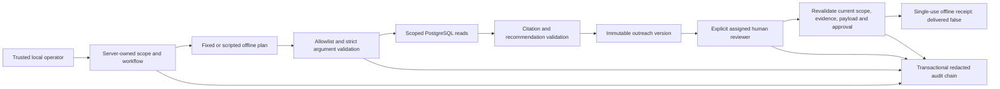

# RevenueOS: bounded workflow delivery

Implemented scoped read tools, cited draft preparation, explicit versioned review, redacted audit, and approval-gated offline rehearsal. Final verification: **145 tests passed; zero failures/errors/skips**. No live-model call or external delivery occurred. Production authentication and the prior recommendation-quality gate remain outstanding.

[Source archive](RevenueOS-Workflow-Source.zip) · [Tool schemas](RevenueOS-Tool-Schemas.json) · [Workflow trace](RevenueOS-Bounded-Workflow-Trace.json) · [Approval rehearsal](RevenueOS-Approval-Rehearsal.json) · [Audit](RevenueOS-Workflow-Audit.json) · [JUnit results](workflow-tests.xml) · [Provenance](RevenueOS-Workflow-Provenance.json)

Canonical design and verification documents are preserved in `docs/15-workflow-acceptance.md`, `docs/16-workflow-guide.md`, and `docs/17-workflow-verification.md` inside the source archive. The following sections reproduce those documents for review.

# Bounded workflow increment: executed verification

Date: 2026-10-16, America/Phoenix. Scope: synthetic offline bounded workflows, scoped internal reads, cited recommendations/drafts, explicit approval, audit and security tests. No external model call or message delivery occurred.

## Outcome

Implemented typed read-tool schemas, server-owned scope, four-call dispatch limits, two offline planner attempts, recommendation retry/cost integration, persisted workflow states, transactional audit, immutable action versions, explicit reviewer assignment/inspection/decisions, and single-use approval rehearsal. Migration 0005 adds seven tables; the complete application now has 28 tables and two views. No third-party dependency was added. Prior architecture, CRM data, ingestion, SQL analytics, scoring, retrieval and evaluation work is preserved.

Inspection and acceptance criteria preceded implementation. Verification progressed through the workflow dispatcher, approval boundary, and complete operator flow. The pre-existing recommendation expiry assertion was unreachable inside an expected-exception block; it is now a separate executed test. The historical 109-test result is preserved as a past run, not represented as evidence that the unreachable assertion executed.

## Observed checks

| Check | Executed result |
|---|---|
| Pre-existing regressions after migration/expiry-test correction | 110 passed, 71.39 seconds |
| New dispatcher tests | 19 passed, 12.73 seconds |
| Dispatcher plus approval tests | 34 passed, 32.52 seconds |
| Final full suite, PostgreSQL 18.6, `--require-db` | **145 passed, zero failures/errors/skips; 103.88 seconds** |
| Ruff lint and format | Passed; 36 Python files formatted |
| Strict mypy | Passed; 16 source files |
| Dependency consistency | `pip check` passed |
| Migration reversal/re-upgrade | Passed in full suite; all 28 application tables and both views restored |
| Packaging | Offline wheel build passed; no dependency download |
| Operator flow | Automated CLI regression plus separate synthetic demo walkthrough passed |

The full suite includes 35 new workflow/approval/CLI cases plus the corrected independent expiry case. It exercises unknown send/approval/SQL tools; actor/organization/lead/role/URL argument injection; invalid JSON, excess plan calls and strict schemas; repeated calls; deadline checks; retrieved instruction text; parameterized SQL-like queries; audit failure rollback and UPDATE denial; unauthorized audit access; missing/wrong/stale approval; edited payloads; rejection; inactive reviewer; source revocation; suppression; proposal expiry; cross-organization action access; synthetic recipient matching; immutable versions/approvals; and two simultaneous consumers producing exactly one receipt. Existing provider tests still exercise at-most-two retries, refusals, fabricated citations, unknown usage, retained reservations, concurrent budgets and scoped stored-draft access.

These are specific adversarial fixture results, not a comprehensive proof against all prompt injection, inference leakage, or production threats. The deadline test checks stage gating; it does not establish forcible cancellation or a 30-second runtime SLO. Concurrent receipt testing establishes local database single use; no remote-delivery guarantee follows.

Reproduce the full tests using the disposable-database commands in README. The executed test command was:

```powershell
./.venv/Scripts/python -m pytest --require-db --basetemp=work/workflows-final-tests -q --tb=short --junitxml=outputs/workflow-tests.xml
```

The environment explicitly pointed `TEST_DATABASE_URL` at local `revenueos_test` and set `REVENUEOS_TEST_ALLOW_RESET=1`. No production database was used. The loopback PostgreSQL service is stopped after verification. Its ignored synthetic data remains in `work/` for local restart. Hosted CI, Docker execution, deployment, load behavior and backup/restore remain unverified.

## Reviewable evidence

- `outputs/RevenueOS-Tool-Schemas.json`: four exported read contracts with additional fields forbidden.
- `outputs/RevenueOS-Bounded-Workflow-Trace.json`: fixed offline workflow, prepared synthetic payload and failed scripted `send_email` request.
- `outputs/RevenueOS-Approval-Rehearsal.json`: inspected message/hash, missing-approval denial, explicit synthetic reviewer decision, one rehearsal receipt with `delivered=false`, and repeated-use denial.
- `outputs/RevenueOS-Workflow-Audit.json`: redacted events and verified organization audit chain. Raw recipient and document text are absent from audit subjects.
- `outputs/workflow-tests.xml`: actual combined JUnit results.

The walkthrough uses a scripted reviewer persona to test the human-facing command boundary. It does not claim a real human approved an external action. It ran against the separate 1,000-lead synthetic intelligence demo database while tests used their disposable database. Default template generation made zero model attempts; actual provider billing is unmeasured. Existing fictional price-card examples remain simulated.

## Remaining risks and next steps

1. **Recommendation quality remains blocked.** The prior frozen synthetic test had four false abstentions among 15 answerable cases (26.7%, exceeding the 10% target). This increment does not change retrieval/recommendation semantics or rerun a tuned held-out benchmark. Passing workflow tests does not resolve that quality gate. Improve evidence selection on development data and commission a fresh independently labeled challenge set before a new quality claim.
2. **Identity and security are local-demo boundaries.** Actor UUIDs come from a trusted operator. There is no OIDC/session service, authenticated human UI, least-privilege production role deployment or RLS validation. Explicit reviewer assignment cannot prove the caller is human without that identity layer. Keep real customer data and external connectors disabled until those controls and privacy/retention policies are verified.
3. **Prompt injection defenses are layered and incomplete.** Tool authority is allowlisted and server-scoped; output claims must quote approved evidence. Suspicious-text patterns can miss attacks or over-abstain. No live planner or independently evaluated live model is present. A future planner needs counted token reservations, live refusal/timeout tests and a new adversarial evaluation before enablement.
4. **Audit assurance has limits.** Transactional append-only rows and chain verification detect ordinary inconsistency under a trusted database. They do not resist a malicious administrator, full-chain rewrite or suffix truncation. Some pre-action denials and infrastructure failures are not audited. Add authenticated security-event capture, export checkpoints, retention controls and recovery procedures before pilot operation.
5. **Runtime durability is bounded, not fully orchestrated.** Logical stage deadlines and dispatcher statement timeouts do not forcibly stop trusted callbacks or all connection/lock waits. A crash can strand a nonterminal workflow or orphan a completed recommendation. Add worker timeouts, reconciliation, explicit stuck-run recovery and measured concurrency/load tests before promising runtime SLOs.
6. **External actions remain unavailable even after approval.** Future delivery requires a separately authorized connector and outbox/idempotency/reconciliation design. Current receipts explicitly record no delivery. Source revocation and consumption serialize through service locks; direct administrative writes outside those paths remain trusted and require a stronger production policy.
7. **Business evidence is still absent.** No real-business pilot, predictive accuracy, conversion uplift, outreach acceptance rate, realized cost or ROI is claimed. First validate usefulness through an authenticated review-only pilot with agreed outcome definitions and a baseline comparison.

The next useful increment is authenticated review-only access plus recovery/security hardening, alongside development-only retrieval-quality improvements. Live evaluation, real-data admission and delivery each require their outstanding design decisions and explicit authorization. No remote push or deployment was performed; current source remains uncommitted.


---

# Bounded workflows and explicit review

RevenueOS now composes approved reads, cited recommendations, and versioned draft review. This increment is synthetic and offline under the owner's standing instruction. It adds no dependency or external messaging connector. Its fixed default orchestration is useful even without a model; scripted planning exercises adversarial tool selection. The existing optional provider contract is reused for recommendation generation and accounting, with no live calls in verification.

## Flow and authority



The caller supplies organization, actor, dataset and lead to a trusted server function. Models cannot override those fields, choose recipients, provide SQL, invoke URLs, change roles, approve actions, or dispatch messages. Scope is a frozen server object, separate from model arguments. There is no shell, arbitrary database, network, approval, or write tool.

The planner receives only tool schemas; it does not receive secrets or the human approval interface. The dispatcher reads actual data and records result hashes. The recommendation component independently re-fetches authorized evidence and lead context. This avoids treating planner assertions or tool text as business facts. Tool observations do not feed an iterative autonomous model loop; this is a bounded workflow foundation, not evidence of live agent reasoning.

## Read tools

| Tool | Model-supplied arguments | Output and boundary |
|---|---|---|
| `get_lead_context` | None | Scoped synthetic lead source, status, employee band, snapshot IDs/time; excludes name, email and notes |
| `get_priority_explanation` | None | Existing rules/configuration, attention points and evidence; not conversion probability |
| `search_approved_knowledge` | Query of 1–500 characters | Up to five exact approved citations, with membership, validity, current-version and revocation checks |
| `get_metric` | Registered metric name and aware start/end timestamps | Existing scoped analytics and lineage; interval must be positive and at most 366 days |

Metric names are `inbound_leads`, `qualification_rate`, `win_rate`, and `open_pipeline_by_currency`. The first two return the registered lead-metrics group; win rate returns the opportunity-metrics group, preserving numerators and denominators rather than letting a model invent ratios. No custom SQL is accepted. PostgreSQL query parameters treat SQL-like search text as data.

Each schema forbids additional fields. Plans contain one to four calls, are limited to 8 KiB, and get at most two validation attempts. Any denied tool ends the workflow; identical calls terminate as a repeated call, counting the denied attempt. Tool results are capped at 16 KiB. The result-size check occurs after materialization, not as a streaming memory limit. Individual dispatcher transactions use a 1.5-second PostgreSQL statement timeout. The workflow checks a logical deadline of at most 30 seconds between stages and forwards remaining time to generation.

Trusted callbacks, pool waits and initial validation queries are not forcibly cancelled. This is not a measured hard end-to-end latency guarantee. There are at most four tool dispatches, not four total SQL queries: authorization, lineage, validation, auditing and recommendation perform additional bounded operations. A server-controlled worker/process timeout and connection/lock timeouts are needed before offering a hard runtime SLO.

Generation reuses at most two proposal attempts, cost reservations, unknown-usage retention and post-response validation. Planning is local and has no token ledger. Live planner accounting is deliberately unimplemented; only the exact `ScriptedPlanner` fixture class is accepted as an optional planner. Scripted providers and fictional price cards remain labeled as simulated. Default templates create no model attempt. No live invoice cost, predictive accuracy, business lift or ROI is established.

## Review and action lifecycle

`prepare_action` requires the workflow requester and a reviewable recommendation. It resolves the lead's exact synthetic CRM email and only accepts matching reserved `.example` or `.invalid` recipients. It copies the validated subject, controlled phrases and exact evidence into an immutable version. It binds recipient, message, recommendation ID and digest, evidence IDs, payload digest, creator and expiry. The existing recommendation TTL is 24 hours; action versions also expire after 24 hours and cannot extend the original recommendation's validity.

A steward must explicitly assign a reviewer who already has an active knowledge membership. A reviewer can inspect the concrete recipient/message/hash and issue a separate `approve` or `reject` command specifying action, version and digest. The model tool registry has no approval capability. Review requires both the original requester's continuing authorization and the reviewer's own access to every cited source. A steward role alone does not silently imply reviewer status. A requester may be explicitly assigned as a reviewer; separation of duties is not currently mandatory.

Editing creates a new pending version and preserves old approval history. The supported edit is deliberately limited to two validated closing phrases; arbitrary subject/body editing is deferred until it has an equally strong evidence/claim validation policy. An old version's approval cannot authorize a new version. Approved, rejected and pending states are persisted independently of the original workflow's `review_pending` state.

Approval authorizes only an offline rehearsal. `rehearse_action` rechecks hash, current version, expiry, current snapshot, lawful use, suppression, source freshness/revocation, original requester access, executing reviewer access, and approving reviewer's continuing role. The exact recommendation digest must still match. All other delivery modes fail closed. An organization lock followed by an action lock serializes consumption; uniqueness constraints prevent duplicate receipts. The receipt records `mode=offline_rehearsal` and `delivered=false`. This proves one-use local rehearsal, not exactly-once email delivery.

No SMTP/CRM/email adapter, remote outbox, actual send, or model-triggered approval exists. A future real connector needs an authenticated human interface, approved recipient/data policy, transactional outbox, connector idempotency, reconciliation and explicit owner authorization. Database transactions cannot guarantee exactly-once remote delivery. The walkthrough's human role is a scripted synthetic persona, not a claim that a real human authorized an external action.

## Audit and data changes

Migration 0005 adds seven tables: `bounded_workflows`, `workflow_reviewers`, `workflow_audit`, `outreach_actions`, `outreach_versions`, `action_approvals`, and `action_receipts`. The full schema has 28 application tables and two views. Composite foreign keys enforce organization relationships for workflow data, versions and reviewers. Existing data migrations and fixtures are preserved.

Workflow starts, planner attempts, tool requests/results, proposal transitions, reviewer assignments, inspection, decisions and rehearsal attempts append redacted events in the transaction that changes state. Tool subjects and inputs are SHA-256 digests; events retain actor, workflow, outcome, sequence, UTC time and chain linkage. They do not retain raw prompts, draft recipients, document text or arbitrary tool names. This reduces exposure but means hashes alone cannot reconstruct a disputed tool call; the caller's controlled trace is separate evidence. Digests and actor IDs still require access controls and retention policy.

UPDATE/DELETE triggers protect audit events, action versions and approvals. Per-organization sequence allocation and audit writes use an organization-first lock order; document ingestion/revocation also takes that lock to serialize those service operations with review and consumption. The small pilot accepts serialization as a simplicity tradeoff. It is not a throughput benchmark. Direct administrator updates, permission/snapshot/suppression updates outside these service paths, and malicious database owners remain trusted boundaries.

Tool denials and known review/rehearsal denials on accessible actions are committed to the scoped audit. Failures before an accessible workflow/action exists, CLI parser errors, prepare/revise/inspect denials, and database outages do not all create audit events. These need a separate authenticated security-event channel in production. Audit storage failure rolls back the associated state transition; a crash across workflow transactions can leave a nonterminal run or unlinked recommendation. Automatic recovery/resume is not implemented.

The chain verifier detects inconsistent sequence/link/content under a trusted database. A database administrator could disable triggers and rewrite the entire chain, or truncate a suffix. External checkpoints or append-only external storage would be required for stronger tamper evidence. A valid chain is not proof of complete event capture or caller identity.

## Key design decisions and simpler alternatives

| Choice | Why appropriate now | Simpler alternative |
|---|---|---|
| Explicit Python state machine and Pydantic schemas | Fits existing typed modules; small authority surface; no framework migration | Fixed pipeline only, already the default |
| Four scoped read tools and registry of metrics | Explainable permission policy; no arbitrary SQL/network access | One server-built lead evidence bundle |
| Reuse independently validated recommendation path | Keeps citation, suppression and cost checks in one component | Template-only proposals, already the default |
| PostgreSQL persistence and atomic audit/state changes | Reuses deployed dependency and makes review durable | JSON logs, but insufficient for transactional approval |
| Immutable hashed action versions | Binds reviewer decision to the exact visible message | One read-only version with edits disabled |
| Organization/action row locks and unique receipts | Straightforward safe local consumption at small pilot scale | One operator process; fails under concurrent workers |
| Separate explicit reviewer assignment | Prevents a document reader from gaining action authority | A single hard-coded reviewer, less flexible and still requires authenticated identity |
| Offline-only rehearsal | Honors offline scope and exercises governance without a transport | Stop after draft review; no receipt |

PostgreSQL row locks behave as documented in [explicit locking](https://www.postgresql.org/docs/current/explicit-locking.html). Prompt injection and excessive agency are treated as architectural threats consistent with the [OWASP LLM risk catalog](https://owasp.org/projects/top-10-for-large-language-model-applications). Pattern-based suspicious-text checks are defense in depth, not a complete injection detector. The hard boundary is absent write/network tools and server-side validation of every allowed call and output.

## Operator walkthrough

Run migrations and seed the synthetic CRM/knowledge fixtures using the existing guides. Set `DATABASE_URL` in the shell. The following commands use placeholders that must be replaced with inspected synthetic values; they do not auto-approve.

```powershell
./.venv/Scripts/python -m revenueos.workflow_cli schemas
./.venv/Scripts/python -m revenueos.workflow_cli run --organization ORG_UUID --actor REQUESTER_UUID --dataset DATASET_UUID --lead LEAD_UUID --query 'configuration checklist'
./.venv/Scripts/python -m revenueos.workflow_cli prepare --organization ORG_UUID --actor REQUESTER_UUID --workflow WORKFLOW_UUID --recipient SYNTHETIC_CRM_EMAIL
# Steward explicitly assigns the human reviewer.
./.venv/Scripts/python -m revenueos.workflow_cli assign-reviewer --organization ORG_UUID --actor STEWARD_UUID --reviewer REVIEWER_UUID
./.venv/Scripts/python -m revenueos.workflow_cli inspect --organization ORG_UUID --actor REVIEWER_UUID --action ACTION_UUID
# Human reviews the exact inspected payload, then chooses approve or reject.
./.venv/Scripts/python -m revenueos.workflow_cli review --organization ORG_UUID --actor REVIEWER_UUID --action ACTION_UUID --version VERSION --hash PAYLOAD_HASH --decision approve
./.venv/Scripts/python -m revenueos.workflow_cli rehearse --organization ORG_UUID --actor REVIEWER_UUID --action ACTION_UUID --hash PAYLOAD_HASH
./.venv/Scripts/python -m revenueos.workflow_cli audit --organization ORG_UUID --actor STEWARD_UUID
```

`revise --action ACTION_UUID --version VERSION --closing 'What would you like to clarify?'` also requires the original organization/requester arguments and returns a new version/hash for separate review. Rehearsal before approval or repeated consumption exits with status 2. This CLI is a trusted local synthetic operator tool: supplying an actor UUID is not user authentication. Do not expose it as a multi-tenant service or admit real customer data. Production identity, least-privilege runtime roles, RLS/tenant security validation, backup/restore, retention/erasure and operational recovery remain prerequisite work.


---

# Bounded workflow acceptance criteria

Date: 2026-10-16. Existing Python/SQLAlchemy/Pydantic/PostgreSQL stack, four migrations and 109-test prior report inspected before coding. Source is uncommitted; preserve existing work. Continue offline under the owner's standing instruction. No new framework, provider dependency, external service, or messaging connector is needed.

1. Add a server-owned workflow state machine with typed read-tool schemas for lead context, score explanation, approved document search, and registered SQL analytics. Scope organization, actor, dataset, and lead from the request, never model arguments. Model cannot supply SQL, URLs, organization IDs, recipients, permissions, approval, or executable code.
2. Bound total tool dispatches to four, offline planner attempts to two, proposal provider attempts to two, a logical wall-clock deadline to 30 seconds, and result sizes. Denied/repeated tool calls count toward the limit. Failed/unknown-usage proposal attempts remain accounted. No hidden transport retries. Planning has no remote provider or token cost; trusted callbacks are not forcibly preempted.
3. Persist workflow states and append-only redacted audit events with sequence/hash verification, actor and run linkage. Record denied calls and validation failures without raw model instructions, prompts, lead PII, or document contents. Audit failure must prevent a successful state transition.
4. Query only approved scoped read tools, retrieve exact supporting citations, and reuse existing conservative recommendation validation and cost reservations. Persist tool evidence hashes and source/config versions. Treat retrieved text and planner output as untrusted data; server policy is authoritative.
5. Add explicit human review of an immutable action version binding recipient, channel, rendered message, source recommendation, evidence, hash, reviewer, and expiry. Only a DB-assigned human reviewer may approve; no model tool can request, grant, or consume approval. Editing creates a new version and invalidates old approval. Suppression, new CRM snapshot, revocation, changed access, expiry, and payload mismatch block use.
6. External connectors remain disabled. Implement a transactionally recorded, single-use **offline rehearsal** that requires approval and records a dry-run receipt. It must not send messages or claim delivery. Unknown action types and real delivery requests fail closed, even when an approval exists. Synthetic recipients only.
7. Test prompt injection in planner calls and retrieved documents, cross-scope/lead attempts, freeform SQL/URL/tools, invalid schemas, repeated calls/loops, retries/unknown usage/budgets, audit rollback/tampering, unauthorized approval, stale/edited approval, expiry, and concurrent approval consumption. Re-run existing regressions on PostgreSQL and migration reversal.
8. Export schemas, representative traces and verification results. Preserve prior failed recommendation-quality gates and unverified live-model/production-security status; bounded orchestration does not establish semantic quality.

Inspection correction: an expiry assertion in the previous recommendation test was unreachable after an expected exception. Move it into its intended test and execute it; previous test counts remain historical evidence, not proof that that assertion ran.

Design choices: an explicit state machine and bounded typed dispatcher fit the established non-eve stack. A fixed pipeline remains the simpler alternative and default offline behavior; a scripted planner exercises tool choice adversarially. An append-only PostgreSQL audit chain detects accidental modification but is not administrator-resistant tamper-proof storage. A durable outbox for real delivery would require a separate connector, idempotency, privacy and operational review; a database transaction cannot guarantee exactly-once remote email delivery.
